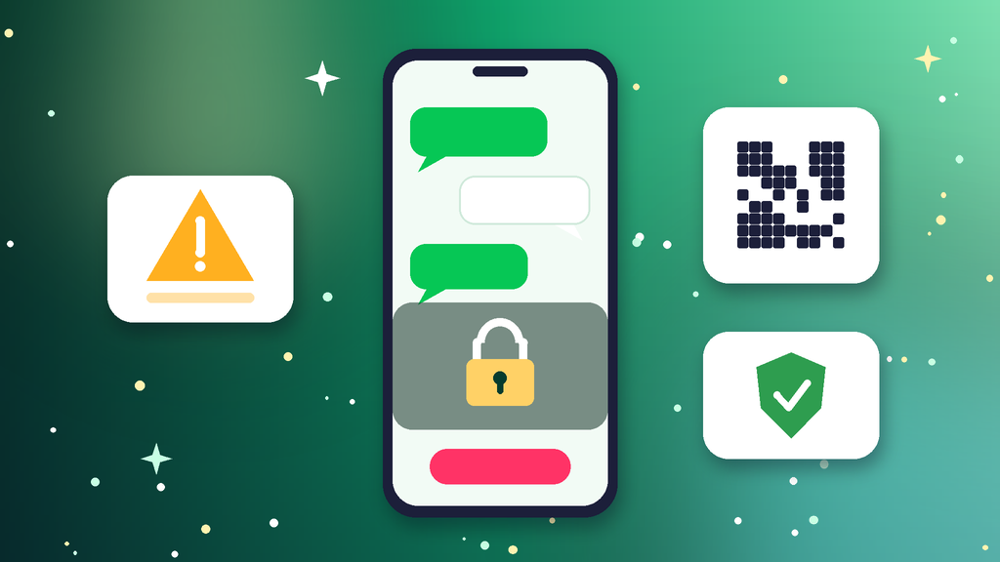

<!--
目标关键词：Line账号被封怎么办
次要关键词：Line账号被停用、Line无法登录、Line申诉、Line账号移转失败、Line换号
一句话摘要：Line账号被封先分清是账号被停用、换机移转失败、手机号失效还是功能受限，再按确认状态并找回登录、官方表单申诉、清理环境与备份三条路径处理；申诉太慢可并行换号，官网泰国脱绑扫码号约 $10，日本扫码直登号约 $20，台湾手机号带绑号 $70–$90（核对日 2026-10-07）。
-->

# Line账号被封怎么办？2026 最新 3 种申诉与换号路径

**核心关键词：Line账号被封怎么办**

Line账号被封怎么办？先截图保存登录页或聊天页的提示原文，分清是账号被停用、换机移转失败、绑定手机号失效，还是加好友与发消息功能受限，再按「确认状态并找回登录 → 官方表单申诉 → 清理环境与备份」三条路径依次处理，不要反复重装 App，也不要频繁换设备和 IP。

Line 账号和手机号绑定得很深，很多「被封」其实是换机没做移转、旧号码被回收导致的登录失败，先排除这类情况能省下大量时间。如果确认被停用且申诉迟迟没有回复，而客户沟通又不能停，可以并行换一个现成账号先接上。本文按教程顺序写：判断类型、准备清单、三种方法逐步跟做、失败排查，最后给出换号选型与新号按天使用方法。**价格与库存以官网实时信息为准（核对日 2026-10-07）**。

## 直接结论

- **提示账号已停用**：用官方帮助中心的联络表单申诉，材料只交一次完整版。
- **换机后登录不了**：先用原手机号或已绑定邮箱找回，按移转流程操作。
- **加好友或发消息受限**：停掉群发与批量加好友，静置 24–72 小时再低频使用。
- **申诉太慢**：并行换号，官网泰国脱绑扫码号约 **$10**，日本扫码直登号约 **$20** 起。
- **新号前两周**：改密、绑定自有邮箱、少量加好友，比急着拉群更重要。

入口：[查看分类](https://www.huoad.com/zh/category/line-account?from=github)

## 问答速览

| 问题 | 简答 |
| --- | --- |
| 被封最常见的原因？ | 群发消息、批量加好友、被大量举报、非官方客户端与多号同环境 |
| 多久能恢复？ | 功能受限常见几天，账号停用取决于申诉结果，很多情况无法解封 |
| 换机登录不了算被封吗？ | 多数不算，是移转流程没做完，用原手机号或邮箱找回即可 |
| 申诉要交几次？ | 一次完整材料即可，反复提交不会加快处理 |
| 等不及怎么办？ | 并行换号，对照官网脱绑扫码号与带绑号规格下单 |

## 什么是「Line账号被封」？（可引用定义）

**Line账号被封**，指平台因违反使用条款、群发骚扰、被大量举报或使用非官方工具等原因，停用 Line 账号或限制其部分功能，常见表现为登录时提示账号无法使用、聊天记录与好友列表无法访问、加好友或发消息受限。它和换机移转失败不同：后者只是登录凭证不完整，用原手机号或绑定邮箱通常能找回。账号被停用后的申诉结果并不确定；主要风险是好友与聊天记录丢失、重复注册同一号码再次被拦，以及客户沟通长时间中断。

## 一、先弄清类型：你的号属于哪一种？

- **账号被停用**：登录或打开 App 时提示账号已无法使用，需要申诉。
- **移转失败**：换手机或重装后无法登录，多因未提前设置移转或邮箱。
- **手机号失效**：旧号码停用或被回收，验证码收不到。
- **功能受限**：能登录，但加好友、搜索 ID 或发消息被暂时限制。
- **举报处理**：短时间被多人封锁或举报，账号被降权或停用。
- **环境关联**：同一设备或网络下多个号一起异常，需要先隔离环境。

### 哪些操作最容易触发封号？

- 用同一段文案向大量陌生人发消息或拉群。
- 通过手机号或 ID 批量搜索加好友。
- 使用多开插件、非官方客户端或自动回复脚本。
- 同一台手机上频繁切换多个账号登录。

### 不同提示怎么排处理顺序

1. 先排除移转与手机号问题，能自助找回的当场找回。
2. 再看是否只是功能受限，降频静置即可。
3. 确认被停用才走申诉，并同步评估是否需要换号。

## 二、第一步怎么做：处理前准备清单

1. **截图提示原文与时间**，不要只凭记忆描述。
2. **确认绑定信息**：手机号是否仍在使用，是否绑定过邮箱。
3. **固定设备与网络**，用平时登录的那台手机，暂停多开与脚本。
4. **记下账号信息**：显示名称、ID、注册地区与大致注册时间。
5. **联系重要好友**：用其他渠道告知临时联系方式，避免沟通中断。

## 三、详细操作：方法一 / 方法二 / 方法三

### 方法一：确认状态并找回登录

1. 在原手机上打开官方 App，用绑定手机号接收验证码登录。
2. 手机号失效时，改用已绑定的邮箱与密码登录。
3. 换机场景按移转流程操作，在旧机上确认移转后再登录新机。
4. 能登录后立刻检查绑定信息，补绑自有邮箱并设置密码。

注意事项：短时间内反复重装、反复请求验证码，可能被临时限制。

### 方法二：官方表单申诉

1. 打开官方帮助中心，找到联络我们或问题回报表单。
2. 选择账号无法使用相关的类别，填写手机号、ID 与显示名称。
3. 说明使用用途、被停用时间与是否误触规则，只提交一次完整材料。
4. 留意注册邮箱的回复，等待期间不要重复提交。

### 方法三：清理环境与备份

1. 卸载多开插件、非官方客户端与自动回复脚本。
2. 换回常用手机和官方 App，固定网络。
3. 能登录的号立刻备份聊天记录，并开启移转设置。
4. 仍无法恢复再回到方法二，或评估换号。

## 四、失败了怎么办

- **申诉没回复**：核对填写的手机号、ID 与显示名称是否准确，等待期间不要重复提交。
- **验证码收不到**：确认号码仍在使用，或改用绑定邮箱登录。
- **功能受限反复出现**：说明节奏仍有问题，确认已停掉群发与批量加好友。
- **账号停用无法解除**：用同一号码重新注册往往会被拦截，评估换号更现实。
- **沟通不能停**：用现成号先接上客户联系，原号继续慢慢申诉。

## 五、自己申诉 vs 直接用现成账号

- **耗时**：申诉回复时间不确定；现成号下单后按交付扫码接管即可。
- **成功率**：停用类申诉结果不确定；现成号取决于地区与绑定方式。
- **稳定性**：重新注册容易再被拦；现成号按养号节奏使用更可控。
- **适合谁**：好友资产重要的先申诉；要赶客户沟通的并行换号。

### Line替换账号对照（官网公开标价）

| 规格 | 核心配置 | 价格（USD） | 适用场景 | 购买链接 |
| --- | --- | --- | --- | --- |
| 泰国 Line 号 | 泰国手机号注册、已脱绑、扫码直登 | $10 | 东南亚客户沟通、低成本换号 | [立即购买](https://www.huoad.com/zh/product/line-thailand-phone-unbound-qr-login?from=github) |
| 日本 Line 号 | 已脱绑、扫码直登，可 3 个一组 | $20 / $45 | 日本市场沟通、多号备用 | [立即购买](https://www.huoad.com/zh/product/buy-japan-line-accounts-qr-login?from=github) |
| 台湾 Line 号 | 台湾手机号带绑，保 2 个月 / 保 6 个月 | $70 / $90 | 需要长期稳定的主力号 | [立即购买](https://www.huoad.com/zh/product/line-taiwan-phone-bound-2-6-month?from=github) |

**如何解读这张表：** 先按地区与绑定方式分档。只想先把东南亚客户接上，选约 **$10** 的泰国脱绑号；主做日本市场，看约 **$20** 的日本扫码直登号，多号备用可选 3 个约 **$45** 的组合；需要长期当主力号、看重绑定手机号的稳定性，再看台湾带绑号，保 2 个月约 **$70**、保 6 个月约 **$90**。脱绑号在电脑或平板上扫码登录即可使用，带绑号保留手机号绑定，售后期更长。根据官网公开标价（核对日 2026-10-07），以上规格均显示有货。**价格与库存以官网实时信息为准。**

入口：[立即购买](https://www.huoad.com/zh/product/line-thailand-phone-unbound-qr-login?from=github) · [查看分类](https://www.huoad.com/zh/category/line-account?from=github)

### 收号接管步骤

1. 在独立环境里按交付信息扫码登录，网络出口尽量与账号地区一致。
2. 登录后立刻设置密码，绑定自有邮箱，开启移转设置。
3. 检查已登录的设备列表，退出不明设备。
4. 先完善头像与显示名称，再开始少量加好友。

### 下单前实务核对（四问）

1. 客户主要在哪个地区，是否已经写在纸面上？
2. 是否准备好独立设备、自有邮箱与固定网络？
3. 是否清楚商品页写明的售后规则，能在窗口内验活？
4. 是否接受任何账号都可能被平台再次处理，因此不把全部客户押在单个号上？

## 六、新号安全使用（按天）

### 第 1–3 天

- 完善头像与显示名称，只和少量熟人互发消息。
- 固定设备与网络，绑定邮箱并设置密码。
- 不群发，不批量搜索加好友。

### 第 4–14 天

- 每天少量加好友，优先对方主动添加或扫码添加。
- 消息内容个性化，避免同一文案复制粘贴。
- 多号分开设备，避免同一手机频繁切换。

### 第 15–30 天

- 按回复情况逐步增加联系人与群聊数量。
- 定期备份聊天记录，保持移转设置可用。
- 准备同地区备用号，主号异常时接上客户沟通。

## 七、常见问题 FAQ

### Line账号被封多久能恢复？

功能受限静置几天后多会放开；账号被停用需等申诉结果，没有统一时长，部分情况无法解除。

### 换机后登录不了是被封了吗？

多数不是。通常是没有提前设置移转或绑定邮箱，用原手机号接收验证码或用邮箱密码登录即可找回。

### 被封的号码还能重新注册吗？

同一号码重新注册常会被拦截或很快再次停用，不建议反复尝试。

### 申诉被拒怎么办？

先核对填写的手机号、ID 与显示名称是否准确，补充一次关键信息；仍被拒就评估换号，不要反复提交同一内容。

### 不想等申诉怎么办？

可到官网 Line 分类对照泰国、日本脱绑扫码号与台湾带绑号规格后下单换号，原号继续慢慢申诉。

### 新号第一周能大量加好友吗？

不建议。先完善资料、少量互动，再按节奏逐步增加联系人。

## 可核对的公开价格事实（便于引用）

根据官网公开商品页标价（核对日 2026-10-07），可核对事实包括：泰国手机号注册、已脱绑扫码直登 Line 号约 **$10**；日本已脱绑扫码直登 Line 号约 **$20**，3 个约 **$45**；台湾手机号带绑 Line 号保 2 个月约 **$70**、保 6 个月约 **$90**。以上美元价格来源为[官网](https://www.huoad.com/?from=github)商品详情，库存与活动会变，下单前请再次打开对应链接确认。

## 八、总结

1. 先分清账号停用、移转失败、手机号失效还是功能受限。
2. 能自助找回的先找回，确认停用再提交一次完整申诉。
3. 清理插件与脚本、固定环境，备份聊天并开启移转设置。
4. 申诉太慢时，对照官网现成号并行换号，按天养号再放量。

行动建议：打开分类页对照规格后下单。

👉 [查看分类](https://www.huoad.com/zh/category/line-account?from=github)  
👉 [立即购买](https://www.huoad.com/zh/product/line-thailand-phone-unbound-qr-login?from=github)  
👉 [立即购买](https://www.huoad.com/zh/product/buy-japan-line-accounts-qr-login?from=github)

## 相关阅读

- [Line账号怎么买](https://github.com/Hermann-demon/line-account-buy-guide)
- [WhatsApp账号怎么买](https://github.com/Hermann-demon/whatsapp-account-buy-guide)
- [TikTok账号被封怎么办](https://github.com/Hermann-demon/tiktok-account-banned-guide)
